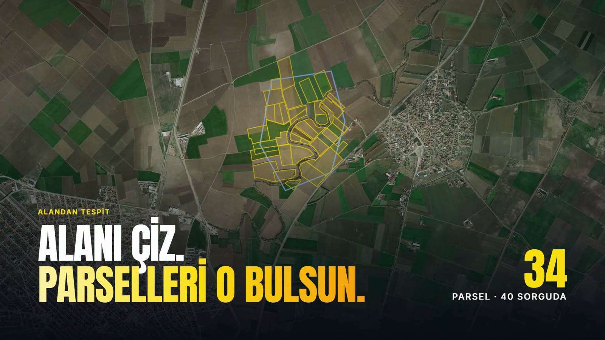

<p align="center">
  <picture>
    <source media="(prefers-color-scheme: dark)" srcset="web/marka/logo-koyu.svg">
    
  </picture>
</p>

# Parsel Sorgu +

TKGM parsel sorgulama ve dışa aktarma aracı. [parselsorgu.tkgm.gov.tr](https://parselsorgu.tkgm.gov.tr/)'nin kullandığı servisten parsel bilgisi ve sınırlarını çeker, kaydeder; KML (Google Earth) ve Excel olarak dışa aktarır.

- Sorgulanan her parsel yerel bir veritabanında tutulur, **aynı parsel için TKGM'ye ikinci kez gidilmez** (TKGM IP başına günlük sorgu limiti uyguluyor).
- Haritaya tıklayarak sorguda, tıklanan nokta kayıtlı bir parselin içindeyse sorgu harcanmaz.
- Alan Yöneticisi (cadplugin) ve parselsorgu'nun kendi KML'leri, `fav_list.json` dosyaları içe aktarılabilir.
- **Alandan parsel tespiti:** OSB/plan sınırını (KML/KMZ, çok katmanlı Netcad projesi dahil) yükle ya da haritada pinle çiz; içindeki/kesişen parselleri seç, kaplanmamış boşlukları gör ve sorgu bütçesiyle TKGM'den tara; sınırla birlikte KML'e, alan içi m²'leriyle Excel'e aktar.
- **Görsel:** alan renkleri (özel renk dahil), çizgi kalınlığı ve tipi, dokuz tarama tipi; katman sırası, alan adları, ada/parsel numaraları. Haritaya yazı, ok, görsel/PDF (taranmış planı döndürüp oturtma, beyazı saydam yapma) ve Excel/CSV tablosu eklenir; lejant öğeleri seçilir.
- **Çıktı:** seçilen alan ya da A4/A3 sayfa (yön, ölçek, 150/300 dpi); başlık ve tarih, lejant, kuzey oku ve ölçek, ITRF96/ED50 koordinat ızgarası; sayfaya logo, tablo ve yazı. PNG ve PDF olarak indirilir.
- Excel çıktısında köşe koordinatları **ITRF96 3°** (TUREF, EPSG:5253–5259) ya da **ED50 3°** (EPSG:2319–2325) olarak verilir. Y = sağa, X = yukarı.

**Tanıtım sitesi:** https://parselsorgu-plus.vercel.app

## Tanıtım videosu

[](https://parselsorgu-plus.vercel.app/#tanitim)

Görsele tıklayınca sitede oynatılır · [MP4 dosyası](video/parsel-sorgu-tanitim.mp4) (33 sn, 1920×1080) · Kaynağı: [`video/`](video/)

## İndir (Windows 10/11)

**[Son sürümü indir](https://github.com/efetuncer1-creator/parselsorgu-plus/releases/latest)** → `ParselSorguPlus-Kurulum-x.y.z.exe`

- Kurulum yönetici izni istemez. Başlat menüsüne (istersen masaüstüne) **Parsel Sorgu +** kısayolu ekler.
- Uygulama kendi penceresinde açılır (Chrome; yoksa her Windows'ta hazır gelen Edge). Pencereyi kapatınca uygulama da kapanır.
- Sorgular senin bilgisayarından gider: TKGM'nin günlük sorgu limiti her kullanıcının kendisinindir. Verilerin (önbellek) `%LOCALAPPDATA%\ParselSorguPlus` klasöründe durur.
- Kurulum dosyası imzasız olduğu için Windows ilk açılışta "Windows bilgisayarınızı korudu" diyebilir: **Ek bilgi → Yine de çalıştır**.

## Kaynaktan çalıştırma

Python 3.11 veya üstü gerekir.

```bash
pip install -r requirements.txt
```

Windows'ta `baslat.bat`'a çift tıkla, ya da:

```bash
python -m parselapp.server
```

Tarayıcıda `http://127.0.0.1:8765/` açılır. Sunucu sadece bu bilgisayardan erişilebilir.

Bir klasördeki KML/JSON dosyalarını komut satırından toplu içe aktarmak için:

```bash
python -m parselapp.ice_aktar "C:\yol\Export Folder"
```

## Testler

TKGM'ye bağlanmaz, örnek dosyalar uydurmadır.

```bash
python -m unittest -v
```

## Güncelleme yayınlama

Güncelleme geçmişinin tek kaynağı [`site/guncellemeler.json`](site/guncellemeler.json). Sitedeki [Güncellemeler](https://parselsorgu-plus.vercel.app/guncellemeler) sayfası da GitHub'daki sürüm notu da buradan beslenir.

1. `site/guncellemeler.json`'da `surumler` listesinin **en üstüne** yeni sürümü ekle. Not türleri: `yeni`, `iyilestirme`, `duzeltme`. Hazır değilse `"taslak": true` yaz; sitede görünmez.
2. `"taslak"` satırını kaldır, commit'le ve gönder. Site birkaç dakika içinde güncellenir.
3. Etiketi gönder; GitHub kurulum dosyasını derler ve notu sürüm sayfasına yazar:

```bash
git tag v0.1.2
git push origin v0.1.2
```

O sürümün notu yoksa ya da hâlâ taslaksa derleme baştan durur ve sürüm yayınlanmaz.

## Yapı

| Dosya | Görev |
|---|---|
| `parselapp/tkgm.py` | TKGM servisine bağlanan tek dosya. TKGM bir şey değiştirirse burası düzeltilir. |
| `parselapp/store.py` | SQLite kaydı, günlük sorgu sayacı |
| `parselapp/importers.py` | KML / GeoJSON içe aktarma |
| `parselapp/exporters.py` | KML ve Excel çıktısı |
| `parselapp/coords.py` | ITRF96 / ED50 3° dönüşümleri |
| `parselapp/referans.py` | Alan (referans) dosyalarını okuma, katmanlar, sınır katmanı önerisi |
| `parselapp/analiz.py` | Alan özeti, boşluklar, boşluk tarama |
| `parselapp/server.py` | Yerel sunucu ve JSON uç noktaları |
| `parselapp/masaustu.py` | Masaüstü başlatıcısı: sunucu + uygulama penceresi |
| `packaging/` | Kurulum paketi (PyInstaller + Inno Setup) ve sürüm notu; `v*` etiketiyle GitHub Actions üretir |
| `site/` | Tanıtım sitesi (Vercel); `guncellemeler.json` güncelleme geçmişi |
| `web/` | Harita ekranı (Leaflet) |
| `data/` | Parsel veritabanı (depoya girmez) |
| `test-kml/` | Elle deneme için gerçek KML'ler; İçe aktar ile yüklenir (depoya girmez) |

## Notlar

- Alanlar TKGM'nin verdiği tapu alanıdır; uygulama alan hesaplamaz.
- TKGM koordinatları yaklaşık 1 m hassasiyettedir (5 ondalık basamak). ED50 dönüşümü EPSG'nin Türkiye parametreleriyle yapılır (yaklaşık ±2 m).
- Veriler TKGM'ye aittir. Servisi aşırı yüklememek için istekler arasında bekleme vardır.
